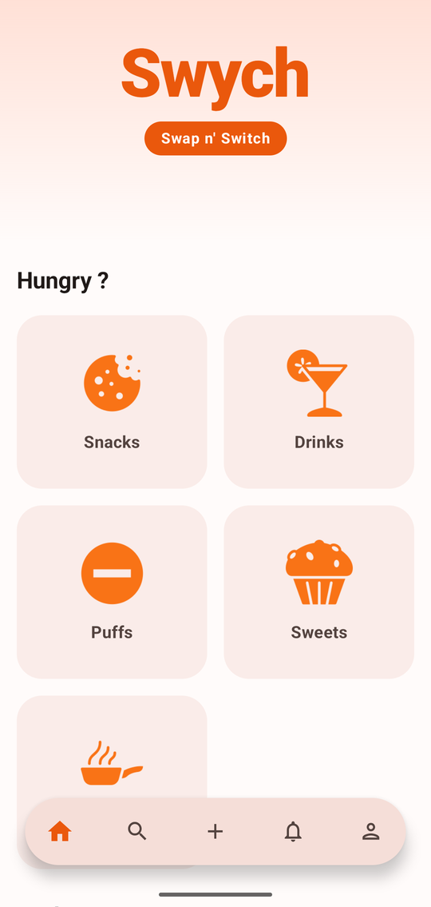
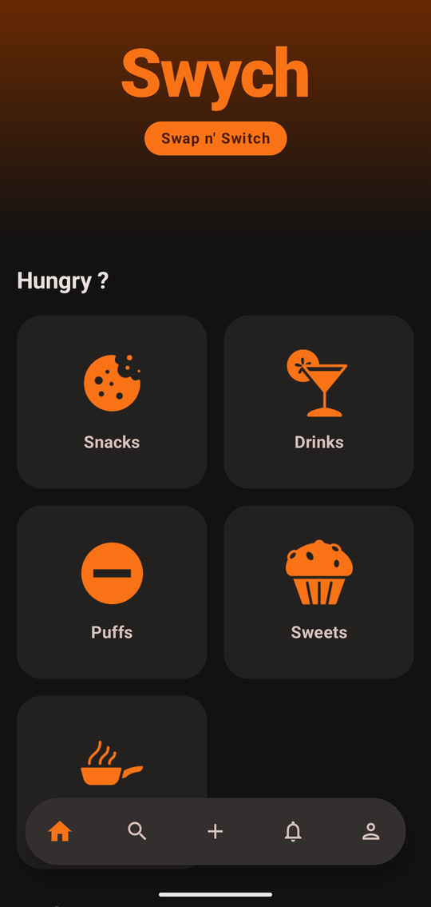
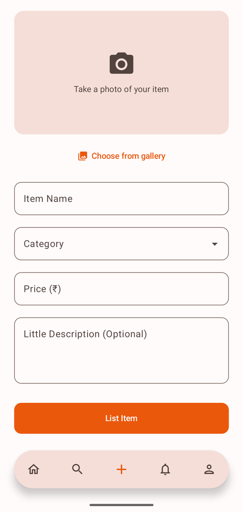
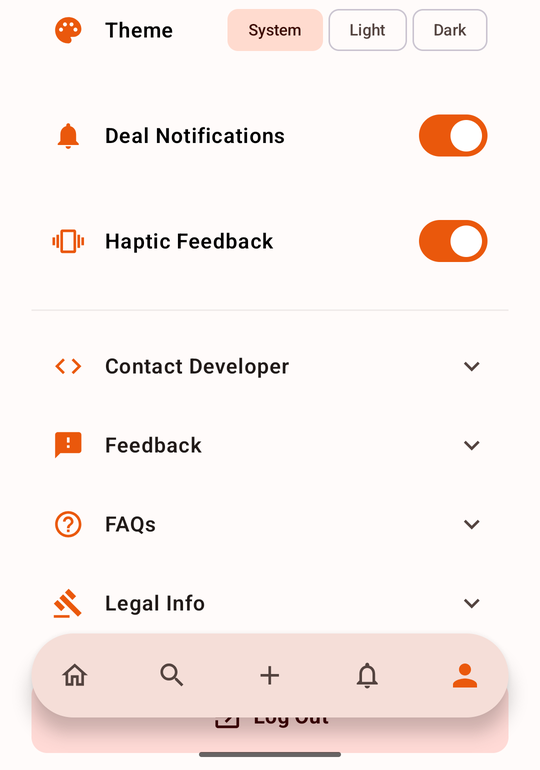
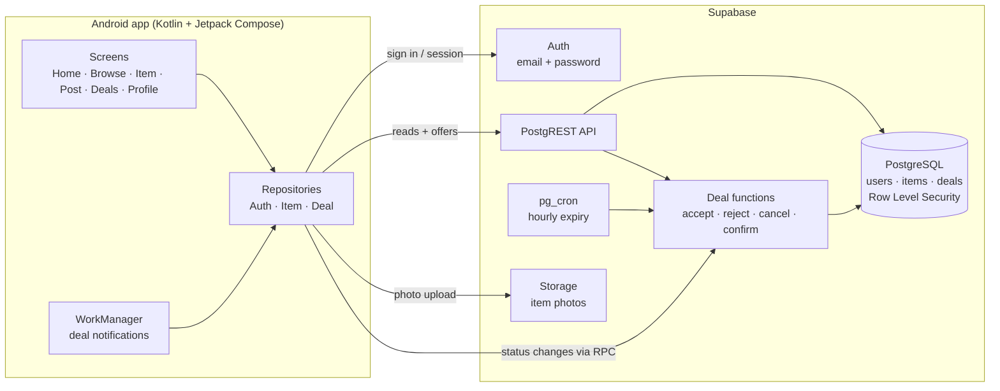

<div align="center">


# Swych (Swap n' Switch)

A campus marketplace for VIT students: list what you don't need, find what you do,
and hand it over on campus.

[](https://github.com/redrighthand2007/SWYCH/actions/workflows/android.yml)
[](https://kotlinlang.org/)
[](https://developer.android.com/jetpack/compose)
[](https://supabase.com/)
[-4C1?logo=android&logoColor=white&labelColor=4c1)](https://developer.android.com/studio/releases/platforms)

</div>

## 📸 Screenshots

<p align="center">
  
  
  
  
</p>

## ✨ Features

- **Browse by category**: 24 student categories, filtered by campus or your hostel block, sorted by newest or price.
- **List in seconds**: take a photo (or pick one from the gallery), set a price, done. Photos are resized before upload.
- **Offers, not DMs**: offer the listed price with one tap, or make your own offer from the item page.
- **Safe hand-overs**: an accepted deal reserves the item; both sides confirm with **Done** after meeting up.
- **Phone numbers stay private**: the other person's number is only revealed once a deal is accepted.
- **Reputation**: green dots for completed deals, red dots for deals you cancelled.
- **Notifications**: new offers, accepted/rejected offers and deal updates, even when the app is closed.
- **Your data, your call**: edit or remove listings, and delete your account from Profile.
- **Light / dark / system theme** and haptic feedback, both switchable in Profile.

## 🔄 How a deal works

```text
Buyer offers ──► PENDING ──► seller Accepts ──► ACCEPTED ──► both tap Done ──► COMPLETED
                    │                              │   (item reserved)          (item sold)
                    ├─ seller Rejects ─► REJECTED  ├─ either side Cancels ─► CANCELLED (item back on sale)
                    └─ buyer Withdraws (removed)   └─ nobody confirms in 3 days ─► EXPIRED (item back on sale)
```

- Accepting one offer automatically rejects the other offers on that item.
- A buyer can have only one live offer per item; offers on reserved or sold items are refused.
- Every status change runs in a Supabase database function, in one transaction, so a deal can't end up half-updated.
- Expired deals are closed by an hourly scheduled job.

## 🏗️ Architecture



- **The server owns the rules.** The app can read and create offers, but every status change
  (accept, reject, cancel, confirm, expire) is a Postgres function that checks who is calling
  and updates the deal, the item and the other offers in one transaction.
- **Row Level Security everywhere.** Users only see their own deals; phone numbers and emails
  aren't readable at all except through a function that reveals the other side's number once a
  deal is accepted.
- **Session-driven navigation.** The logged-in state comes from the Supabase session itself, so
  an expired session sends the user back to login instead of failing silently.

## 💡 Technical highlights

- Designed a **deal state machine** (pending → accepted → completed / rejected / cancelled /
  expired) and enforced it in the database with constraints, partial unique indexes (one live
  offer per buyer, one accepted deal per item) and row locks against double-accepts.
- Moved from client-side multi-step updates to **transactional RPCs**, removing a class of
  half-finished deals caused by network failures.
- **Locked down data access** with Row Level Security and column-level grants; verified the full
  flow (offer → accept → confirm → cancel → expire → account deletion) with rolled-back SQL tests
  run as real users.
- **Notifications without a push server**: a WorkManager job compares deal state with what the
  user last saw and only alerts on changes that matter to them; the in-app check pauses when the
  app goes to the background.
- **Release hardening**: R8 shrinking with keep rules (found and fixed a release-only crash in
  WorkManager's database and stripped resources loaded by name), image downscaling and EXIF
  rotation before upload, friendly error mapping that never shows raw database errors.
- **CI** on every push: unit tests, Android lint and a debug build via GitHub Actions.

## 🛠️ Tech Stack

- **App:** Kotlin, Jetpack Compose, Material 3, Navigation Compose (type-safe routes), Coil, WorkManager
- **Backend:** Supabase — Auth, PostgREST, Storage, `pg_cron`
- **Database:** PostgreSQL with Row Level Security; deal logic in `SECURITY DEFINER` functions

## 📁 Project Structure

```text
SWYCH/
├── app/src/main/java/com/kush/swych/
│   ├── core/
│   │   ├── data/              # Repositories: auth, items, deals
│   │   ├── designsystem/      # Theme, colors, typography, shared components
│   │   ├── model/             # User, Item, Deal, Category + status constants
│   │   ├── network/           # Supabase client
│   │   ├── notifications/     # Deal notifications and background check
│   │   └── util/              # Settings, errors, images, haptics
│   └── ui/
│       ├── auth/              # Welcome, sign-up, login
│       ├── home/              # Category grid
│       ├── browse/            # Marketplace feed
│       ├── itemdetail/        # Item page, offers, edit/remove own listing
│       ├── postitem/          # New listing
│       ├── deals/             # Offers and My Products
│       ├── profile/           # Profile, settings, logout, delete account
│       ├── main/              # Tabs and bottom bar
│       └── navigation/        # Routes and session-based navigation
├── app/src/test/              # Unit tests
├── supabase/migrations/       # Database schema, functions and access rules
├── .github/workflows/         # CI: tests, lint, build
└── docs/                      # Logo, screenshots and privacy policy
```

## ⚙️ Getting Started

1. **Clone**
   ```bash
   git clone https://github.com/redrighthand2007/SWYCH.git
   ```
2. **Configure Supabase** — add your project's URL and publishable key to `local.properties`
   in the project root (this file is git-ignored):
   ```properties
   supabase.url=https://<your-project>.supabase.co
   supabase.key=<your publishable key>
   ```
   See [Using your own Supabase project](#-using-your-own-supabase-project) to set up the database.
3. **Open** the folder in Android Studio and let Gradle sync.
4. **Run** on an emulator or device with Android 8.0 (API 26) or newer.

Sign-up only accepts `@vitstudent.ac.in` email addresses.

## 🔧 Using your own Supabase project

1. Create a [Supabase](https://supabase.com/) project with the `users`, `items` and `deals` tables
   and a public storage bucket named `items`.
2. Apply the SQL files in [`supabase/migrations/`](supabase/migrations) in order. They add the deal
   functions, constraints, sign-up trigger, access rules and the hourly expiry job.
3. Put your project URL and publishable key in `local.properties` (see Getting Started). The
   publishable key is meant to ship inside the app; the database is protected by Row Level
   Security, not by keeping the key secret. Never put the `service_role` key in the app.
4. In Supabase → Authentication → Settings, turn on **Leaked password protection**.

## 📦 Release build

The release build is shrunk with R8. To sign it with your own key, create `keystore.properties`
in the project root (it is git-ignored):

```properties
storeFile=../swych-release.jks
storePassword=...
keyAlias=swych
keyPassword=...
```

Without that file the release build is signed with the debug key, which is fine for testing but
not for the Play Store. Then run:

```bash
./gradlew bundleRelease
```

Before publishing, host the [privacy policy](docs/PRIVACY_POLICY.md) at a public URL and add it to
the Play Console listing.

## 🧪 Tests

```bash
./gradlew testDebugUnitTest lintDebug
```

## 🗺️ Roadmap

- [x] Sign-up / login (email or phone)
- [x] Listings with photos, edit and remove
- [x] Offers, accept/reject, hand-over confirmation, expiry
- [x] Reputation (completed vs cancelled)
- [x] Row Level Security and server-side deal logic
- [x] Notifications (background check)
- [x] Account deletion
- [ ] Instant push notifications (Firebase Cloud Messaging)
- [ ] In-app chat
- [ ] Free / donate listings and a "Wanted" board
- [ ] Report and block, admin moderation

## 📄 License

Distributed under the MIT License. See [`LICENSE`](LICENSE).

## 👨‍💻 Author

**Kush** · GitHub: [@redrighthand2007](https://github.com/redrighthand2007)

## 🙌 Acknowledgements

- [Jetpack Compose](https://developer.android.com/jetpack/compose) for modern Android UI
- [Supabase](https://supabase.com/) for auth, database and storage
- [Icons8](https://icons8.com/) for category iconography
- [Shields.io](https://shields.io/) for the repository badges
