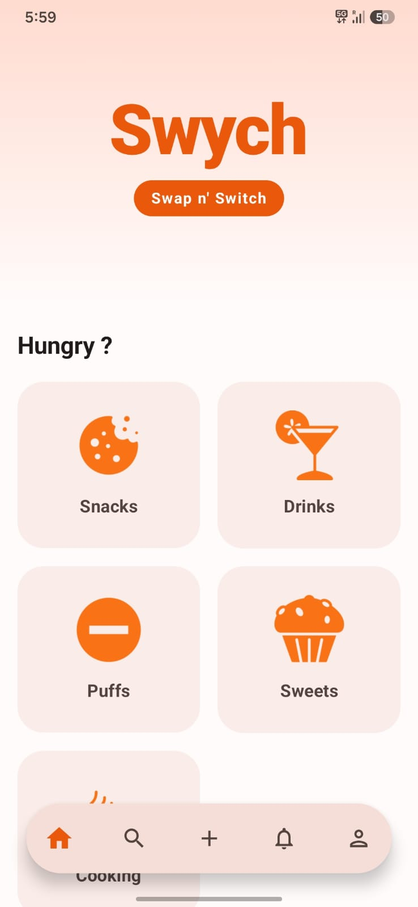
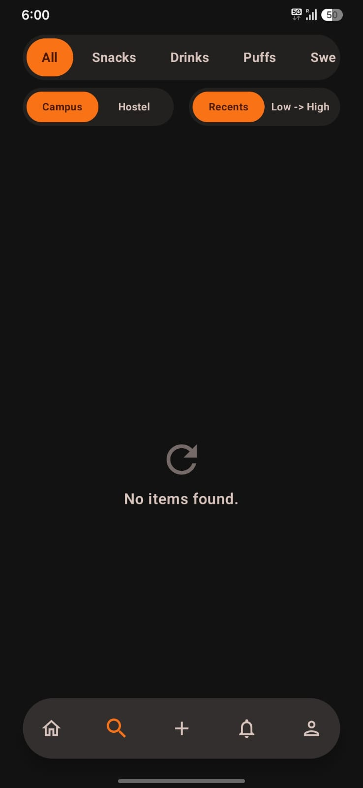
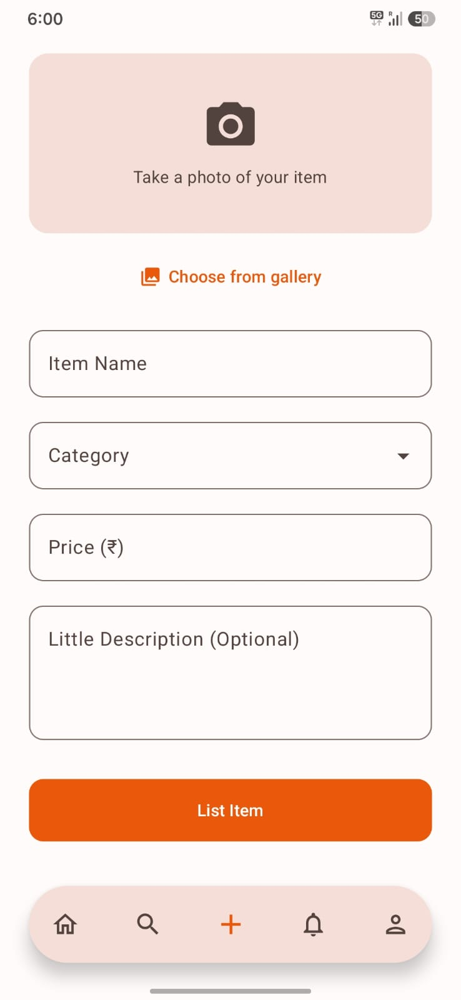
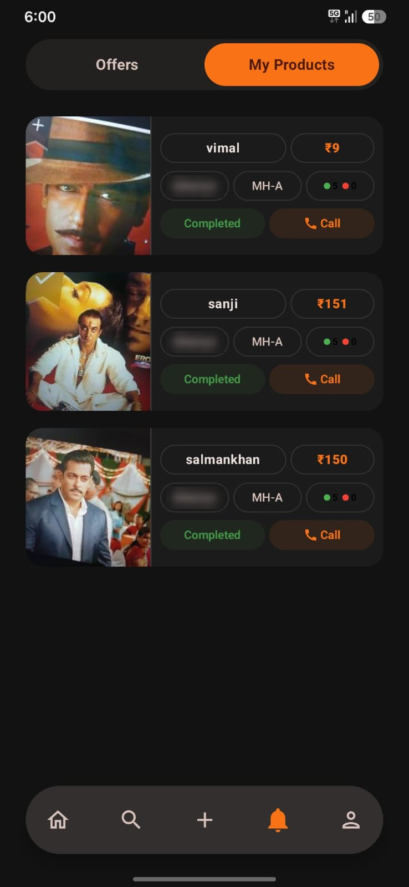
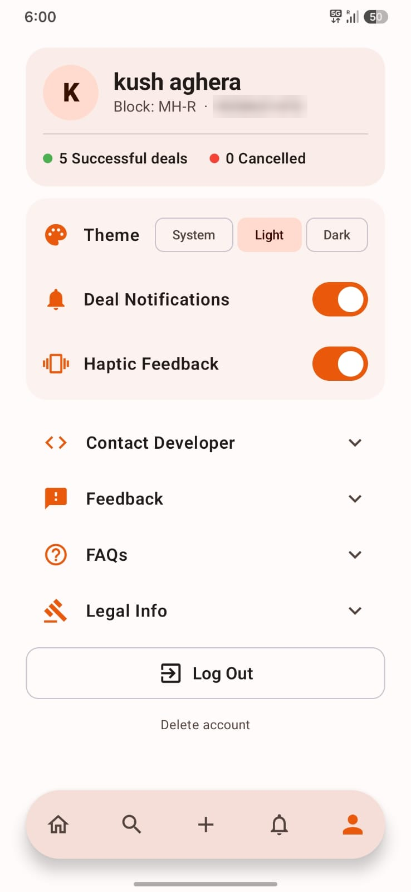
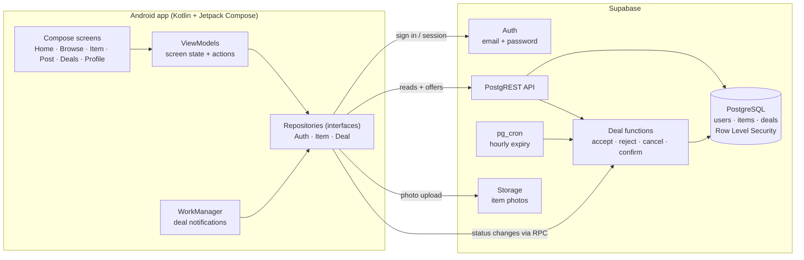

<div align="center">


# Swych (Swap n' Switch)

A campus marketplace for VIT students: list what you don't need, find what you do,
and hand it over on campus.

[](https://kotlinlang.org/)
[](https://developer.android.com/jetpack/compose)
[](https://supabase.com/)
[-4C1?logo=android&logoColor=white&labelColor=4c1)](https://developer.android.com/studio/releases/platforms)
[](LICENSE)

**[⬇️ Download the APK](https://github.com/redrighthand2007/SWYCH/releases/latest)** · [Screenshots](#-screenshots) · [How a deal works](#-how-a-deal-works) · [Architecture](#%EF%B8%8F-architecture)

</div>

## 📸 Screenshots

From picking a category to closing a deal, in light and dark mode:

<table align="center">
  <tr>
    <td align="center"></td>
    <td align="center"></td>
    <td align="center"></td>
    <td align="center"></td>
    <td align="center"></td>
  </tr>
  <tr>
    <td align="center"><b>Home</b><br/><sub>Pick a category · Light</sub></td>
    <td align="center"><b>Browse</b><br/><sub>Filter and sort · Dark</sub></td>
    <td align="center"><b>Post</b><br/><sub>List in seconds · Light</sub></td>
    <td align="center"><b>Deals</b><br/><sub>Offers and sales · Dark</sub></td>
    <td align="center"><b>Profile</b><br/><sub>Reputation and settings · Light</sub></td>
  </tr>
</table>

## ✨ Features

- **Browse by category**: 24 student categories, filtered by campus or your hostel block, sorted by newest or price.
- **List in seconds**: take a photo (or pick one from the gallery), set a price, done. Photos are resized before upload.
- **Offers, not DMs**: offer the listed price with one tap, or make your own offer from the item page.
- **Safe hand-overs**: an accepted deal reserves the item; both sides confirm with **Done** after meeting up.
- **Phone numbers stay private**: the other person's number is only shared while a deal is accepted, and hidden again once it's done.
- **Buy and Sell in one place**: your offers and your listings, sortable by latest or by product.
- **Golden V badge**: sign up with any email; VIT students verify their `@vitstudent.ac.in` address from Profile (one email link) and get a gold **V** next to their name on listings and deals.
- **Upvotes and downvotes**: thumbs up or down on any listing to rate its seller, one vote per listing; totals show on cards and profiles, next to completed and cancelled deal counts.
- **Notifications**: new offers, accepted/rejected offers and deal updates, also when the app is closed (checked about every 15 minutes).
- **Your data, your call**: edit or remove listings, and delete your account from Profile.
- **Light / dark / system theme** and haptic feedback, both switchable in Profile.

## 🔄 How a deal works

```text
Buyer offers ──► PENDING ──► seller Accepts ──► ACCEPTED ──► both tap Done ──► COMPLETED
                    │                              │   (item reserved)          (item sold)
                    ├─ seller Rejects ─► REJECTED  ├─ either side Cancels ─► CANCELLED (item back on sale)
                    └─ buyer Withdraws (removed)   └─ nobody confirms in 3 hours ─► EXPIRED (item back on sale)
```

- Accepting one offer automatically rejects the other offers on that item.
- A buyer can have only one live offer per item; offers on reserved or sold items are refused.
- Every status change runs in a Supabase database function, in one transaction, so a deal can't end up half-updated.
- Expired deals are closed by an hourly scheduled job.

## 🏗️ Architecture



- **The server owns the rules.** The app can read and create offers, but every status change
  (accept, reject, cancel, confirm, expire) is a Postgres function that checks who is calling
  and updates the deal, the item and the other offers in one transaction.
- **Row Level Security everywhere.** Users only see their own deals; phone numbers and emails
  aren't readable at all except through a function that reveals the other side's number once a
  deal is accepted.
- **MVVM with Hilt.** Each screen has a `@HiltViewModel` holding its state and actions;
  Hilt injects the repositories, which are interfaces backed by Supabase implementations.
  ViewModels scoped to the main screen keep Browse results, filters and a half-written listing
  when switching tabs or rotating the phone.
- **Session-driven navigation.** The logged-in state comes from the Supabase session itself, so
  an expired session sends the user back to login instead of failing silently.

## 💡 Technical highlights

- Designed a **deal state machine** (pending → accepted → completed / rejected / cancelled /
  expired) and enforced it in the database with constraints, partial unique indexes (one live
  offer per buyer, one accepted deal per item) and row locks against double-accepts.
- Moved from client-side multi-step updates to **transactional RPCs**, removing a class of
  half-finished deals caused by network failures.
- **Locked down data access** with Row Level Security and column-level grants; verified the full
  flow (offer → accept → confirm → cancel → expire → account deletion) with rolled-back SQL tests
  run as real users.
- **Notifications without a push server**: a WorkManager job compares deal state with what the
  user last saw and only alerts on changes that matter to them; the in-app check pauses when the
  app goes to the background.
- **Release hardening**: R8 shrinking with keep rules (found and fixed a release-only crash in
  WorkManager's database and stripped resources loaded by name), image downscaling and EXIF
  rotation before upload, friendly error mapping that never shows raw database errors.
- **Unit tests** for every key ViewModel (login, sign-up, browse filters, posting, deal actions)
  using fake repositories, plus deal states, categories and error mapping; clean Android lint.

## 🛠️ Tech Stack

- **App:** Kotlin, Jetpack Compose, Material 3, MVVM, Hilt, Navigation Compose (type-safe routes), Coil, WorkManager
- **Backend:** Supabase — Auth, PostgREST, Storage, `pg_cron`
- **Database:** PostgreSQL with Row Level Security; deal logic in `SECURITY DEFINER` functions

## 📁 Project Structure

```text
SWYCH/
├── app/src/main/java/com/kush/swych/
│   ├── core/
│   │   ├── data/              # Repository interfaces + Supabase implementations
│   │   ├── di/                # Hilt modules (Supabase client, repositories)
│   │   ├── designsystem/      # Theme, colors, typography, shared components
│   │   ├── model/             # User, Item, Deal, Category + status constants
│   │   ├── network/           # Supabase client
│   │   ├── notifications/     # Deal notifications and background check
│   │   └── util/              # Settings, errors, images, haptics
│   └── ui/
│       ├── auth/              # Welcome, sign-up, login
│       ├── home/              # Category grid
│       ├── browse/            # Marketplace feed
│       ├── itemdetail/        # Item page, offers, edit/remove own listing
│       ├── postitem/          # New listing
│       ├── deals/             # Buy and Sell: offers, deals and listings
│       ├── profile/           # Profile, settings, logout, delete account
│       ├── main/              # Tabs and bottom bar
│       └── navigation/        # Routes and session-based navigation
├── app/src/test/              # Unit tests (ViewModels with fake repositories)
├── baselineprofile/           # Records the startup Baseline Profile and measures cold start
├── supabase/migrations/       # Database schema, functions and access rules
├── supabase/functions/        # Edge Functions: phone login and the VIT badge email
└── docs/                      # Logo, screenshots, privacy policy
```

## ⚙️ Getting Started

### Requirements

- A recent **Android Studio** that supports Android Gradle Plugin 9.2 (Gradle 9.4 is downloaded
  automatically by the wrapper)
- **JDK 21**: Android Studio's bundled JDK works; Gradle provisions it automatically if missing
- **Android SDK 35** and a device or emulator running **Android 8.0 (API 26)** or newer
- A free [Supabase](https://supabase.com/) project (see below)

### Run it locally

1. **Clone**
   ```bash
   git clone https://github.com/redrighthand2007/SWYCH.git
   cd SWYCH
   ```
2. **Set up the backend** — follow [Supabase setup](#-supabase-setup) below (about 5 minutes).
3. **Add your Supabase keys** to `local.properties` in the project root. Android Studio creates
   this file on first sync; it is git-ignored, so keys never end up in the repository.
   ```properties
   supabase.url=https://<your-project-ref>.supabase.co
   supabase.key=<your publishable key>
   ```
4. **Open** the folder in Android Studio, let Gradle sync, and press **Run ▶**.

Any email can sign up. Students who sign up with (or later verify) a `@vitstudent.ac.in`
address get the verified **V** badge (see
[Adapting it to another college](#-adapting-it-to-another-college)).

## 🔧 Supabase setup

1. **Create a project** at [supabase.com](https://supabase.com/) (the free tier is enough).
2. **Run the migrations** in [`supabase/migrations/`](supabase/migrations), oldest first. Either
   paste each file into **SQL Editor → New query → Run**, or use the
   [Supabase CLI](https://supabase.com/docs/guides/cli):
   ```bash
   supabase init        # only if supabase/config.toml doesn't exist yet
   supabase link --project-ref <your-project-ref>
   supabase db push
   ```
   | File | What it creates |
   |---|---|
   | `20261001000000_initial_schema.sql` | `users`, `items`, `deals` tables, the `items` photo bucket, RLS switched on |
   | `20261021000000_deal_workflow.sql` | Deal statuses and constraints, deal functions, sign-up trigger, access rules |
   | `20261025000000_launch_readiness.sql` | Hourly expiry job (`pg_cron`), photo upload rules, account deletion |
   | `20261115000000_college_email_only.sql` | Old college-only email rule (removed again by the next file) |
   | `20261116000000_any_email_vit_badge.sql` | Any email can sign up; `vit_verified` badge and pending VIT verifications |
   | `20261117000000_cleanup_deleted_users.sql` | Deleting a user in the dashboard also removes their profile, listings and deals |
   | `20261118000000_three_hour_deals.sql` | Accepted deals expire after 3 hours (checked every 10 min); numbers shared only while a deal is accepted |
   | `20261119000000_phone_login_and_speed.sql` | Phone login moves to an Edge Function; indexes and faster access rules |
   | `20261120000000_votes.sql` | Upvotes / downvotes per listing, seller totals, one shared account clean-up |
3. **Copy your keys** from **Project Settings → API Keys**: the project URL and the
   **publishable** key go into `local.properties`. The publishable key is meant to ship inside the
   app; the data is protected by Row Level Security, not by keeping that key secret.
   **Never** put the `secret` / `service_role` key in the app.
4. **Auth settings** (Authentication → Sign In / Providers → Email):
   - Email provider: **enabled**
   - *Confirm email*: optional. When on, new users must click the link before logging in, which
     stops sign-ups with someone else's college address.
   - *Leaked password protection*: Pro plan only; leave off on the free plan.
5. **VIT badge emails** (optional): deploy the two Edge Functions and give them a Gmail sender
   (an [app password](https://myaccount.google.com/apppasswords), never your real password):
   ```bash
   supabase functions deploy request-vit-verification
   supabase functions deploy confirm-vit-email --no-verify-jwt
   supabase functions deploy phone-login --no-verify-jwt
   supabase secrets set SMTP_USER=<gmail address> SMTP_PASS=<gmail app password>
   ```
   Without the secrets everything else works; Profile just says verification isn't available yet.

### Troubleshooting

| Problem | Fix |
|---|---|
| App closes at launch with *"Supabase is not configured"* | `supabase.url` / `supabase.key` missing from `local.properties`; add them and rebuild |
| *"This item is no longer available"* on every action | Migrations not applied, or applied out of order |
| Sign-up fails with *"already registered"* | That phone number or email is already used by another account |
| Photos don't upload | The `items` bucket is missing; re-run the first migration |

## 🎓 Adapting it to another college

- **Verified email domain**: change `@vitstudent.ac.in` in
  [`ProfileViewModel.kt`](app/src/main/java/com/kush/swych/ui/profile/ProfileViewModel.kt),
  [`request-vit-verification`](supabase/functions/request-vit-verification/index.ts) and the
  `handle_new_user` trigger in the latest migration.
- **Hostel blocks**: edit `HOSTEL_BLOCKS` in
  [`Constants.kt`](app/src/main/java/com/kush/swych/core/util/Constants.kt).
- **Categories**: add or remove entries in
  [`Category.kt`](app/src/main/java/com/kush/swych/core/model/Category.kt) (name, Home section
  and icon); Home, Browse and Post update automatically.

## 📦 Release build

The release build is shrunk with R8. To sign it with your own key, create `keystore.properties`
in the project root (it is git-ignored):

```properties
storeFile=../swych-release.jks
storePassword=...
keyAlias=swych
keyPassword=...
```

Without that file the release build is signed with the debug key, which is fine for testing but
not for the Play Store. Then run:

```bash
./gradlew bundleRelease
```

Before publishing, host the [privacy policy](docs/PRIVACY_POLICY.md) at a public URL and add it to
the Play Console listing.

## 🧪 Tests

```bash
./gradlew testDebugUnitTest   # unit tests: ViewModels, deal states, categories, errors
./gradlew lintDebug           # Android lint
./gradlew assembleRelease     # shrunk release build (catches R8 issues the debug build hides)
```

## ⚡ Startup performance

The app ships a [Baseline Profile](https://developer.android.com/topic/performance/baselineprofiles/overview):
a list of the code used at launch, which Android compiles ahead of time at install, so even the first
launch after installing the APK is fast. To re-record it after big changes, connect a phone (Android 13+)
or emulator and run:

```bash
./gradlew :app:generateBaselineProfile
```

To compare cold-start time with and without it:

```bash
./gradlew :baselineprofile:connectedBenchmarkReleaseAndroidTest
```

## 🗺️ Roadmap

- [x] Sign-up / login (email or phone)
- [x] Listings with photos, edit and remove
- [x] Offers, accept/reject, hand-over confirmation, expiry
- [x] Reputation: upvotes / downvotes, completed vs cancelled deals
- [x] Row Level Security and server-side deal logic
- [x] Notifications (background check)
- [x] Account deletion
- [x] Any-email sign-up with a verified VIT badge
- [ ] Instant push notifications (Firebase Cloud Messaging)
- [ ] In-app chat
- [ ] Free / donate listings and a "Wanted" board
- [ ] Report and block, admin moderation

## 📄 License

© 2026 Kush Aghera. All rights reserved. The source is public so it can be viewed and evaluated;
copying, redistributing or reusing it requires written permission. See [`LICENSE`](LICENSE).

## 👨‍💻 Author

**Kush** · GitHub: [@redrighthand2007](https://github.com/redrighthand2007)

## 🙌 Acknowledgements

- [Jetpack Compose](https://developer.android.com/jetpack/compose) for modern Android UI
- [Supabase](https://supabase.com/) for auth, database and storage
- [Icons8](https://icons8.com/) for category iconography
- [Shields.io](https://shields.io/) for the repository badges
